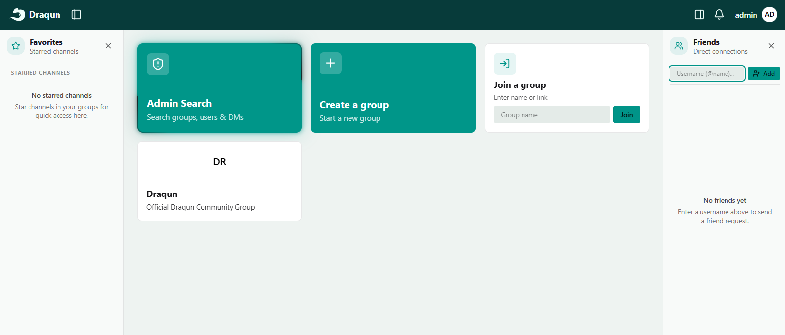
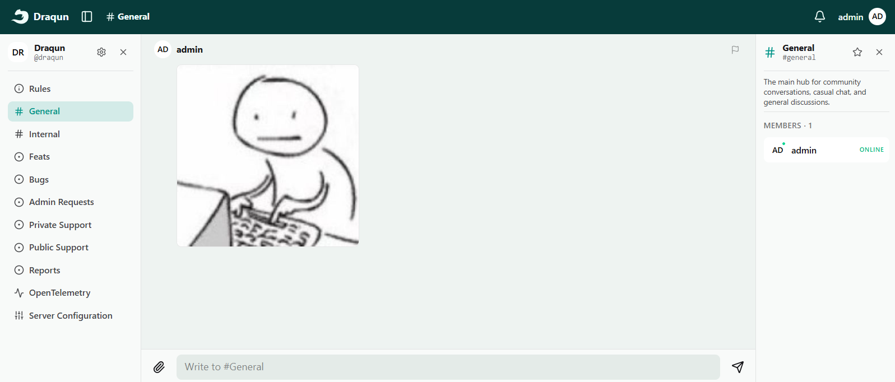

 

# Draqun

A social super-app, created to unify multiple ecosystems into one, extendable node-based platform.

<!-- ## Installation

You can install Draqun server by downloading the latest release from the
[releases page](https://github.com/Mopsgamer/draqun/releases/latest). -->

Draqun is currently in active development. Check out the [contributing guide](CONTRIBUTING.md) and read the [philosophy](PHILOSOPHY.md).

## Who needs it?

Mostly content makers, artists, local event organizers, small TV studios, small businesses/startups, students/universities, public sector/government, and enthusiasts who don't want to use multiple different apps and passwords.

## What Draqun Does

Draqun provides social capabilities such as Private Messages, Friend System, Private/Public Groups, Permissions as core concepts.

Primary capabilities are exposed as Channels. Different types of Channels can be created within a Group:

- [x] Text: Chat with other members of a Group, send links, pictures, files, music and polls.
- [x] Wall: Write a big message with ability to attach files.
- [x] Tickets: Create and manage support tickets, which can be closed, linked to other tickets, closed as duplicate, or assigned to a user.
- [ ] Stream: Live streaming and real-time viewer chat.
- [ ] Survey: Creating and managing polls or tests.
- [ ] Calendar: Schedule and manage events, goals and tasks.
- [ ] Materials: Store and share educational resources, sell products or publish videos.
- [ ] Voice: Communicate with other members or take interviews with ability to create multiple sound streams for recording. You can watch videos together here too.
- [ ] Jobs: Create and manage job postings and applications.

Using Permissions and Notifications settings you can enhance these channels further: news channels (Text or Wall); Private/Public feedback and reviews (Tickets); Subscriptions (assign Permissions to Roles).

Use sub-channels to create forums, discuss intensive topics.

### What you can do

Depending on your privacy settings, you can search for: Jobs, Friends, Products, Events, Groups, Content Makers, Videos, Live Streams, Games, Music etc.
